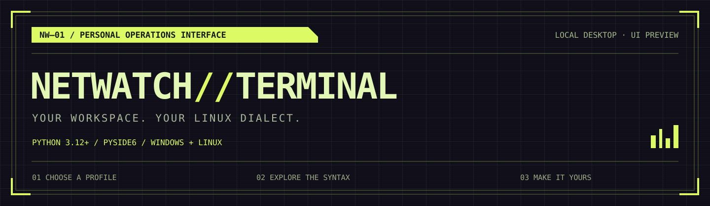
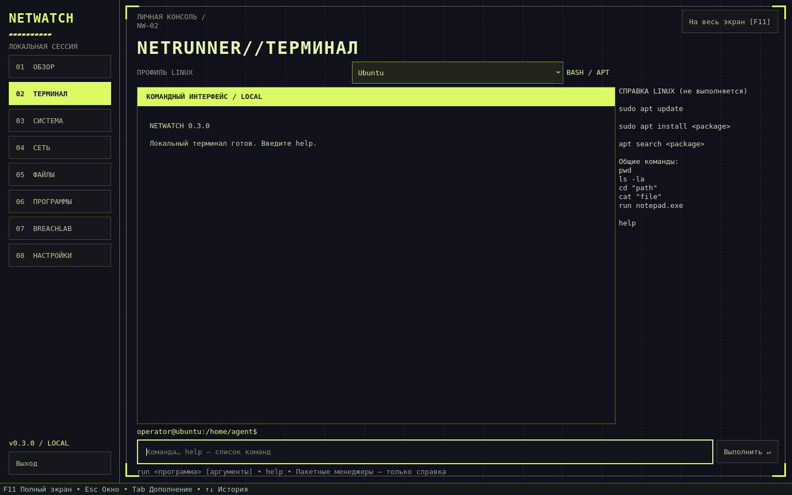
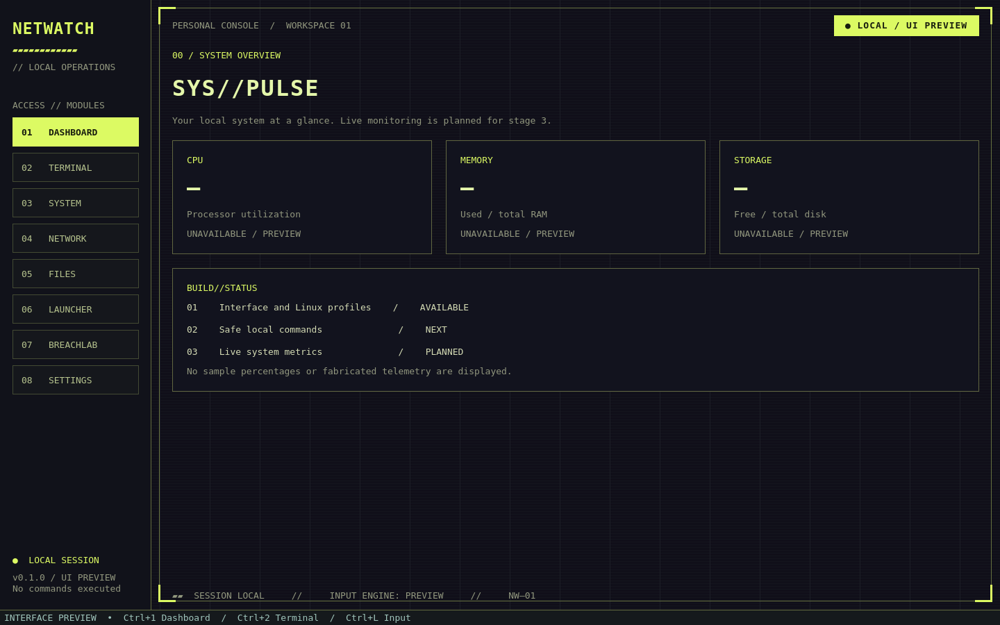
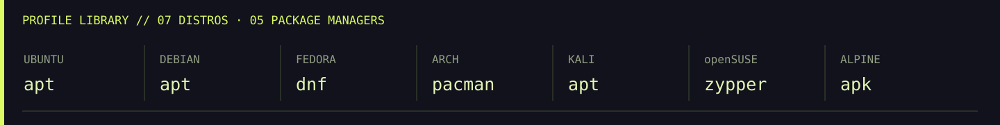

<p align="center">
  
</p>

<p align="center">
  <b>LOCAL FIRST · CYBERPUNK HUD · LINUX SYNTAX PROFILES</b><br>
  Python 3.12+ &nbsp; / &nbsp; PySide6 &nbsp; / &nbsp; Windows 10–11 &amp; Linux
</p>

<p align="center">
  <a href="docs/INSTALL.md">Запуск</a> ·
  <a href="docs/SCREENSHOTS.md">Скриншоты</a> ·
  <a href="docs/FEATURES.md">Возможности</a> ·
  <a href="https://github.com/PANDORA615/Netwatch-Terminal/actions">Сборки</a>
</p>

Локальное desktop-приложение на Python 3.12+ и PySide6 в оригинальном cyberpunk-стиле. Целевая платформа — Windows 10/11 x64; интерфейс также можно запускать в Linux.

## Интерфейс

Лаймовые панели, тонкие технические рамки, статичные скан-линии и тёмный фиолетовый фон. Оформление создано для проекта по мотивам cyberpunk-терминалов; изображения ниже — снимки работающего приложения PySide6.



<table>
  <tr>
    <td width="50%"><br><b>SYS//PULSE</b> — экран системного обзора</td>
    <td width="50%"><br><b>ARCH PROFILE</b> — приглашение и подсказки pacman</td>
  </tr>
</table>



## Текущая версия: этапы 0–1

Готовы src-layout, точка входа, тёмная тема, восемь экранов навигации, клавиатурное управление и заглушки Dashboard/Terminal. Интерфейс по умолчанию английский.

В Terminal доступны профили **Ubuntu, Debian, Fedora, Arch Linux, Kali Linux, openSUSE, Alpine**. Выбор меняет приглашение, справочную оболочку и подсказки пакетного менеджера: `apt`, `dnf`, `pacman`, `zypper`, `apk`. Общие команды `pwd`, `ls`, `cd`, `cat`, `mkdir` имеют общий базовый синтаксис. Shell и пакетный менеджер — разные вещи; профиль не устанавливает дистрибутив и не включает Bash/WSL. Оболочка указана как типичный профиль и может отличаться в конкретной установке. Fedora check-update проверяет обновления, Arch -Syu обновляет систему. Наличие sudo зависит от установки Linux.

Поле ввода принимает текст и показывает уведомление о предпросмотре. **Команды пока не выполняются**, ввод не записывается в историю. Нет реальных системных метрик, файловых операций, сетевых запросов и BreachLab; соответствующие экраны помечены как запланированные. Настройки и выбранный профиль пока действуют только в текущем сеансе; анимации отключены.

## Установка и запуск

**Самый простой способ для Windows — готовая сборка, Python не нужен.**

1. Откройте [GitHub Actions → Desktop checks](https://github.com/PANDORA615/Netwatch-Terminal/actions/workflows/ci.yml).
2. Выберите успешный запуск для ветки `main` с зелёной галочкой.
3. Внизу страницы, в **Artifacts**, скачайте **NetwatchTerminal-Windows-x64**. Для скачивания требуется вход в GitHub.
4. Нажмите на ZIP правой кнопкой → **Извлечь всё**. Сохраните всю распакованную папку, включая `_internal`.
5. Откройте `NetwatchTerminal.exe` из распакованной папки. Не запускайте его прямо из ZIP и не переносите отдельно от остальных файлов.

Это desktop-приложение для Windows 10/11 x64. На Android/iPhone файл `.exe` не запускается. Готовые сборки пока тестовые; отдельного установщика нет.

**[Полный гайд установки →](docs/INSTALL.md)** — установка Python, скачивание без Git, запуск, обновление, Linux и решение ошибок.

### Запуск из исходников в Windows

Установите [Python 3.12 x64](https://www.python.org/downloads/windows/), включая Python Launcher и пункт **Add python.exe to PATH**. Скачайте репозиторий через **Code → Download ZIP**, распакуйте его и откройте PowerShell в папке, содержащей `pyproject.toml` (правый клик в пустом месте папки → **Открыть в Терминале**).

Выполните команды по очереди:

```powershell
py -3.12 --version
py -3.12 -m venv .venv
.\.venv\Scripts\python.exe -m pip install --upgrade pip
.\.venv\Scripts\python.exe -m pip install -e .
.\.venv\Scripts\python.exe -m netwatch_terminal
```

Для следующих запусков откройте PowerShell в той же папке и выполните только последнюю команду. Активация окружения и изменение политики PowerShell не требуются. Интернет нужен для первой установки зависимостей.

## Проверка вручную

1. Откройте Terminal и переключите все профили: приглашение и справка должны обновиться.
2. Введите текст и нажмите Enter или Preview: появится уведомление, ввод очистится, действия не выполнятся.
3. Переключите все разделы слева; Dashboard показывает `unavailable`, а не вымышленные показатели.
4. Проверьте окно размером 1000×650, выделение/копирование вывода и прокрутку справки.
5. `Ctrl+1`…`Ctrl+8` переключают разделы, `Ctrl+L` открывает Terminal и фокусирует ввод; Tab перемещает фокус.

## Тесты и снимок окна

Для разработки сначала установите дополнительные зависимости:

```powershell
.\.venv\Scripts\python.exe -m pip install -e ".[dev]"
```

```powershell
.\.venv\Scripts\python.exe -m pytest -q
.\.venv\Scripts\python.exe -m netwatch_terminal --screenshot docs/terminal-preview.png
.\.venv\Scripts\python.exe scripts/render_previews.py
```

CI запускает pytest и рендер окна на Linux и Windows, затем собирает Windows-приложение. В разделе [Actions](https://github.com/PANDORA615/Netwatch-Terminal/actions) после успешного запуска скачайте артефакт `NetwatchTerminal-Windows-x64`, распакуйте всю папку и запустите `NetwatchTerminal.exe`. Это тестовая сборка; проверка на чистой Windows 10/11 отдельно ещё требуется.

Сборка вручную в Windows:

```powershell
.\.venv\Scripts\python.exe -m PyInstaller --noconfirm --windowed --onedir --name NetwatchTerminal src/netwatch_terminal/__main__.py --paths src
```

## Структура и следующий этап

- `src/netwatch_terminal/app.py` — создание QApplication и запуск.
- `src/netwatch_terminal/core/distributions.py` — профили и справочные команды без зависимости от Qt.
- `src/netwatch_terminal/ui/` — окно, навигация, тема и заглушки.
- `tests/` — импорт, навигация, профили, размеры и безопасный предпросмотр ввода.
- `docs/` — оригинальные SVG-баннеры и скриншоты работающего интерфейса.
- `scripts/render_previews.py` — повторное создание галереи README.
- `.github/workflows/ci.yml` — проверки и Windows-сборка.

Следующий этап ТЗ: собственные CommandParser/Registry/Executor и безопасные `help`, `clear`, `pwd`, `ls`, `cd`, `cat`, `mkdir`, затем история. Полный Bash-синтаксис и произвольный shell-код не планируются. Мониторинг — этап 3, остальные модули — последующие этапы.

Неофициальный фанатский проект. Не связан с CD PROJEKT RED; игровые логотипы, музыка и ассеты не используются. Перед коммерческим выпуском необходимо проверить название и товарные знаки. Код проекта — MIT; сторонние зависимости распространяются по собственным лицензиям (включая Qt/PySide6).
