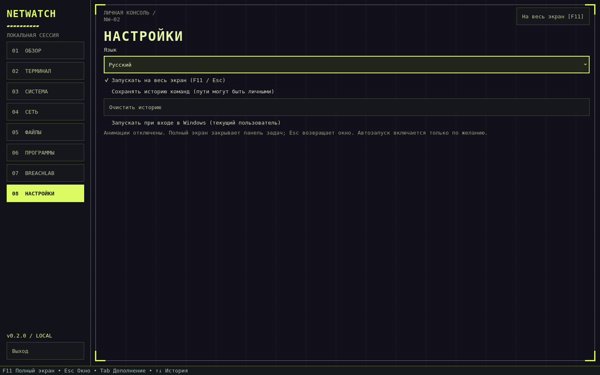
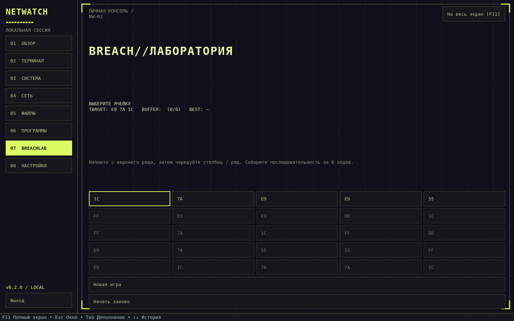

# Скриншоты

[← На главную](../README.md) · [Установка и запуск](INSTALL.md) · [Возможности](FEATURES.md)

Снимки работающего приложения PySide6. Нажмите на изображение, чтобы рассмотреть его крупнее.

## Terminal / Ubuntu

Выбор Linux-профиля, справка пакетного менеджера и поле ввода.

## Terminal / Arch Linux

При выборе Arch меняются приглашение и справочные команды на pacman.

## Dashboard

Системная панель в HUD-теме. Показаны реальные метрики системы, на которой создан снимок.

## Настройки

## BreachLab

